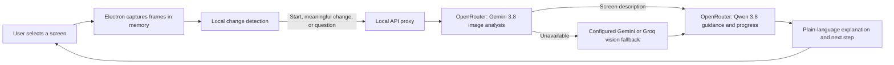

# Screenwise Companion

**Accessible cybersecurity guidance for small teams.** Screenwise is a floating Windows companion that helps nontechnical staff understand security warnings on their screen and choose a safe next step.

## Hackathon problem statement

Small organizations such as community clinics, retail shops, and schools often do not have a dedicated security operations team. Staff may see suspicious emails, browser warnings, or account alerts without knowing what they mean. Security tools can be noisy and use technical language, leaving a receptionist or administrator unsure what to do next.

The challenge is to give these teams clearer threat visibility and practical decision support without requiring cybersecurity expertise.

## Our solution approach

Screenwise acts as a screen-aware cybersecurity companion. It explains what it can see in plain language, distinguishes visible facts from uncertainty, and suggests safe actions the user can carry out themselves. The user remains in control: Screenwise does not click buttons, change settings, block accounts, or take defensive actions automatically.

### User flow

1. The user presses **Start** and selects a screen or app window to monitor.
2. While monitoring is active, the desktop app checks for meaningful screen changes. Captured frames stay in memory and are sent for analysis when monitoring starts, when a change is detected, or when the user asks about the current screen.
3. OpenRouter routes the screen image to Gemini 3.8 Flash for visual analysis. If OpenRouter vision is unavailable, a configured native Gemini or Groq vision key can serve as a fallback.
4. OpenRouter routes the screen description and the user’s question to Qwen 3.8 27B for a short explanation, relevant context, and a clear next step. A configured native Groq key can serve as a chat fallback. The assistant also updates the current goal and progress.
5. The user can ask follow-up questions, pause monitoring, or stop it at any time. When monitoring is paused or stopped, the companion relies on the saved text context rather than a new screen image.

The assistant is designed to avoid interrupting for routine screen changes, while surfacing a useful next step when one is apparent. It should say when the screen is unclear instead of guessing.

## How it works



### Main components

- **Windows desktop app:** Electron provides the always-on-top companion window, screen/window picker, and Start, Pause, Resume, and Stop controls. A React and Vite interface presents the robot companion, chat, explanations, and session progress.
- **Screen awareness:** Electron captures a user-selected source. The app compares small in-memory fingerprints locally and sends a frame for analysis only when needed. Screen images are not saved to disk by the app.
- **AI proxy:** A local Express service keeps provider keys out of the renderer. OpenRouter provides the primary image and chat models through one API. Optional direct Gemini and Groq keys provide fallbacks.
- **Session memory:** A compact text history and progress state are stored in local browser storage. The user can clear them in the app. Images are not included in that saved history.

## Privacy and user control

- Monitoring starts only after the user presses **Start** and chooses a screen or window.
- **Pause** stops sending new frames; **Stop** ends monitoring and releases the selected source.
- The app and local proxy do not write screen frames to disk or log request bodies. Frames are sent to the configured AI provider for analysis, so review that provider’s data handling terms before using Screenwise with sensitive information.
- API keys stay in the local `.env` file and are used by the Node proxy, not the desktop renderer. `.env` is excluded from Git.
- The assistant gives guidance for the user to perform. It does not carry out the recommended actions.

## Run on Windows

1. Install Node.js 22.12 or newer.
2. From this repository folder, run `npm install`.
3. Run `npm run setup:electron` to install Electron’s Windows runtime.
4. Copy `.env.example` to `.env` and add an OpenRouter API key. You can use one key for both tasks or separate vision and chat keys. Direct Gemini and Groq keys are optional fallbacks.
5. Run `npm run dev`.

This starts the local API proxy, the Vite interface, and the Electron desktop window. The proxy listens on `127.0.0.1` by default. The current project runs from source; a Windows installer has not been configured.

## Configure provider keys

OpenRouter is the primary provider. Use a single key for both tasks, or separate keys if you want to manage image analysis and chat independently. Put keys in your local `.env` file; do not commit or share the file.

```env
OPENROUTER_API_KEY=your-openrouter-key
# Optional per-task keys override the shared key for that task.
OPENROUTER_VISION_API_KEY=your-openrouter-vision-key
OPENROUTER_CHAT_API_KEY=your-openrouter-chat-key
```

The default OpenRouter models are Gemini 3.8 Flash for images and Qwen 3.8 27B for chat. Model settings can be changed in `.env`. Direct Gemini and Groq keys remain optional fallbacks:

```env
OPENROUTER_VISION_MODEL=google/gemini-3.8-flash
OPENROUTER_CHAT_MODEL=qwen/qwen3.8-27b
GEMINI_MODEL=gemini-3.8-flash
GROQ_MODEL=qwen/qwen3.8-27b
```

If `.env` contains older lowercase `api1` and `api2` entries, the server uses `api1` for OpenRouter image analysis and `api2` for chat unless standard OpenRouter variables are set.

For remote use, deploy the proxy behind authentication and TLS, then set `VITE_COMPANION_API_URL` before building the renderer. Do not expose the local proxy directly to a public network.

## Checks

```powershell
npm test
npm run typecheck
npm run build
```

The test suite includes screen-change checks and provider-mocked API flow tests, so running the tests does not require real provider keys. Live model calls still require valid keys and any provider account setup they require.

## Current scope

The hackathon MVP focuses on screen awareness, plain-language explanations, step-by-step guidance, progress tracking, and chat about visible content. It is a companion for small organizations, not a replacement for a dedicated security team. The first version does not include integrations with security products or automated remediation.
